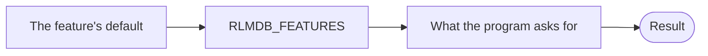

# Features

A *feature* is something rlmdb can do that C LMDB cannot. Each feature
has a name, and it is off until you turn it on.

Features never break compatibility. An environment that a program with a
feature has written is still an ordinary LMDB environment: C LMDB opens,
reads and writes it as before.

## The features

| Feature | Default | What it does |
|---|---|---|
| [`split-freelist`](split-freelist.md) | off | Keeps a large delete from growing the data file. |

## How a feature is set

A feature belongs to one environment handle in one process. It is not
stored in the files. One program can have a feature on while another
program, on the same environment, has it off.

There are two places to turn a feature on: the program, and the
environment variable `RLMDB_FEATURES`. When the environment is opened,
rlmdb combines them in this order:



Each step overrides the one before it. What the program asks for wins.

## Turn a feature on in your program

Name the feature before you open the environment:

=== "C"

    ```c
    #include <rlmdb.h>              /* includes lmdb.h */

    mdb_env_create(&env);
    rlmdb_env_enable_feature(env, "split-freelist");
    mdb_env_open(env, "./data", 0, 0644);
    ```

=== "Rust"

    ```rust
    use rlmdb::{Environment, Feature};

    let env = Environment::builder()
        .enable(Feature::SplitFreelist)
        .open("data")?;
    ```

    To take the name from a configuration file, use
    `.enable_feature("split-freelist")?`, which fails for a name rlmdb
    does not know.

`rlmdb_env_disable_feature` in C and `.disable(...)` in Rust turn a
feature off again, which matters once a feature is on by default.

## Turn a feature on without changing the program

Set `RLMDB_FEATURES` when you start the program:

```sh
RLMDB_FEATURES=split-freelist ./prog
```

This is the way for programs that run on a
[stub](../getting-started/replace-c-lmdb.md), which cannot call rlmdb's
own functions.

The variable holds a list of names, separated by commas or spaces. A `-`
in front of a name turns that feature off:

```sh
RLMDB_FEATURES=-split-freelist ./prog
```

Who reads the variable:

- C programs and the `mdb_*` tools read it.
- Rust programs read it only if they ask for it, with
  `.read_environment(true)` on the builder.
- Programs that run setuid or setgid never read it.

To make sure that no variable changes what a C program does, call
`rlmdb_env_read_environment(env, 0)` before `mdb_env_open`, or set
`RLMDB_IGNORE_ENV=1`.

## A wrong name is an error

A name that rlmdb does not know stops the environment from opening. A
typo does not silently leave the feature off:

```console
$ RLMDB_FEATURES=split-freelst ./prog
RLMDB_UNKNOWN_FEATURE: Unknown feature
```

In a program, `rlmdb_env_enable_feature` returns
`RLMDB_UNKNOWN_FEATURE`, and `.enable_feature(...)` returns an error.

Feature names are never renamed or removed. A program that asks for a
feature today keeps working with later versions of rlmdb.

## Defaults

A feature can change its default over the releases of rlmdb:

- **Off.** You turn it on. This is where every feature starts.
- **On.** You can turn it off.
- **Always on.** The feature has become part of rlmdb. Asking for it
  still works. Turning it off is an error.

## See what a library offers

The version line names the features that a library knows:

```text
rlmdb 0.0.0 (mdb_version 0.0.0; format 0.9 = LMDB 0.9.37; format 1.0 = LMDB 1.0.3; features: split-freelist)
```

A `*` after a name means on by default, a `!` means always on. A C
program gets this line from `rlmdb_version_string()`. To work with the
list in a program, use `rlmdb_features()` in C or `rlmdb::features()`
in Rust.

To check what one environment ended up with, ask it:

=== "C"

    ```c
    int on;
    rlmdb_env_feature_enabled(env, "split-freelist", &on);
    ```

=== "Rust"

    ```rust
    let on = env.feature_enabled("split-freelist")?;
    ```
