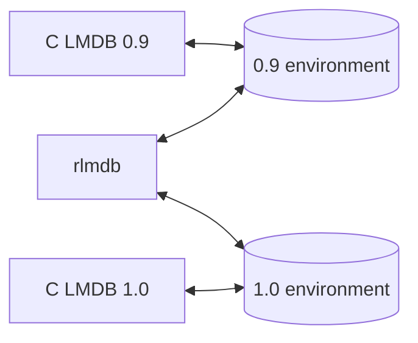

# Use rlmdb in a C program

`librlmdb` has the LMDB C API. A program written for C LMDB compiles
against it as it is: you link with `-lrlmdb` where you linked with
`-llmdb`.

This page builds a small program that stores users, lists them and
searches them. If you know LMDB already, read
[Compile and link](#compile-and-link) and skip to
[Choose a data format](#choose-a-data-format).

## Compile and link

[Install the C libraries](index.md#install-the-c-libraries) first. Then:

```sh
cc -o users users.c $(pkg-config --cflags --libs rlmdb)
```

Without pkg-config, name the directories yourself:

```sh
cc -I/usr/local/include/rlmdb -o users users.c -L/usr/local/lib -lrlmdb
```

??? note "Linking the static library"

    `librlmdb.a` needs a few system libraries.
    `pkg-config --static --libs rlmdb` prints them for your platform:

    === "Linux (glibc)"

        ```sh
        cc -I/usr/local/include/rlmdb -o users users.c /usr/local/lib/librlmdb.a \
           -lgcc_s -lutil -lrt -lpthread -lm -ldl -lc
        ```

    === "macOS"

        ```sh
        cc -I/usr/local/include/rlmdb -o users users.c /usr/local/lib/librlmdb.a
        ```

    === "Windows (MinGW-w64)"

        ```sh
        gcc -I/usr/local/include/rlmdb -o users users.c /usr/local/lib/librlmdb.a \
            -lkernel32 -lntdll -luserenv -lws2_32 -ldbghelp
        ```

## Store and fetch

An LMDB *environment* is a directory with a data file and a lock file.
It holds one or more *named databases*, each with its own keys.
Everything you read or write happens in a transaction.

This program stores five users in a database named `users`, with the name
as the key and the e-mail address as the value, and reads one back:

```c title="users.c"
#include <stdio.h>
#include <string.h>
#include <lmdb.h>

static void print(const MDB_val *name, const MDB_val *email)
{
    printf("%.*s: %.*s\n", (int)name->mv_size, (char *)name->mv_data,
           (int)email->mv_size, (char *)email->mv_data);
}

int main(void)
{
    static const char *users[][2] = {
        { "alice", "alice@example.com" },
        { "bob", "bob@example.com" },
        { "carla", "carla@example.com" },
        { "carlos", "carlos@example.com" },
        { "dave", "dave@example.com" },
    };
    MDB_env *env;
    MDB_txn *txn;
    MDB_dbi dbi;
    MDB_val key, value;
    int rc;
    size_t i;

    /* Open the environment. The directory must exist. */
    if ((rc = mdb_env_create(&env)) ||
        (rc = mdb_env_set_maxdbs(env, 32)) ||   /* named databases open at once */
        (rc = mdb_env_open(env, "./data", 0, 0644)))
        goto fail;

    /* Open the database "users" in a write transaction. The first run
       creates it. Then store the users. */
    if ((rc = mdb_txn_begin(env, NULL, 0, &txn)) ||
        (rc = mdb_dbi_open(txn, "users", MDB_CREATE, &dbi)))
        goto fail;
    for (i = 0; i < sizeof(users) / sizeof(users[0]); i++) {
        key.mv_size = strlen(users[i][0]);
        key.mv_data = (void *)users[i][0];
        value.mv_size = strlen(users[i][1]);
        value.mv_data = (void *)users[i][1];
        if ((rc = mdb_put(txn, dbi, &key, &value, 0)))
            goto fail;
    }
    if ((rc = mdb_txn_commit(txn)))
        goto fail;

    /* Fetch one user in a read transaction. */
    if ((rc = mdb_txn_begin(env, NULL, MDB_RDONLY, &txn)))
        goto fail;
    key.mv_size = 5;
    key.mv_data = "carla";
    rc = mdb_get(txn, dbi, &key, &value);
    if (rc == 0)
        print(&key, &value);
    else if (rc == MDB_NOTFOUND)
        printf("carla: not found\n");
    else
        goto fail;

    /* The next two sections add code here. */

    mdb_txn_abort(txn);         /* ends the read transaction */
    mdb_env_close(env);
    return 0;
fail:
    fprintf(stderr, "%s\n", mdb_strerror(rc));
    return 1;
}
```

```console
$ mkdir data
$ ./users
carla: carla@example.com
```

Four things to take from it:

- **Use a named database for each kind of record.** One transaction can
  change several of them together, and adding one later is a single
  call. LMDB keeps the names in the environment's main database, so keep
  your own records out of that one. The handle from `mdb_dbi_open` stays
  valid after the commit: open a database once and keep the handle.
  `mdb_env_set_maxdbs` says how many this process can have open at once.
  It sizes a table in memory and is not stored in the file.
- **A write is visible when its transaction commits.** Until then no
  other transaction sees it, and `mdb_txn_abort` drops it.
- **A read transaction sees one snapshot.** Writers do not block it, and
  what it reads does not change while it runs.
- **`mdb_get` does not copy.** `value.mv_data` points into the database
  and is valid until the transaction ends. Copy what you need to keep.

`mdb_put` replaces the value of a key that exists; pass `MDB_NOOVERWRITE`
to get `MDB_KEYEXIST` instead. `mdb_del` removes a key.

## Iterate with a cursor

LMDB keeps keys sorted, byte by byte. A cursor walks them in that order.
Add this where the comment is:

```c
MDB_cursor *cursor;

if ((rc = mdb_cursor_open(txn, dbi, &cursor)))
    goto fail;
while ((rc = mdb_cursor_get(cursor, &key, &value, MDB_NEXT)) == 0)
    print(&key, &value);
if (rc != MDB_NOTFOUND)         /* MDB_NOTFOUND is the end of the data */
    goto fail;
```

```text
alice: alice@example.com
bob: bob@example.com
carla: carla@example.com
carlos: carlos@example.com
dave: dave@example.com
```

`MDB_NEXT` on a new cursor starts at the first key. To walk backwards,
use `MDB_PREV`, which starts at the last key. The next section uses the
same cursor and closes it.

## Search with a range query

Because the keys are sorted, a search is a jump followed by a walk.
`MDB_SET_RANGE` moves the cursor to the first key that is equal to or
greater than the one you give. From there, `MDB_NEXT` continues in order
until the keys no longer match.

Here is a search for every name that starts with `car`:

```text
alice
bob
carla     ←  MDB_SET_RANGE "car" lands here: the first key ≥ "car"
carlos    ←  MDB_NEXT
dave      ←  MDB_NEXT: does not start with "car", so stop
```

```c
key.mv_size = 3;
key.mv_data = "car";
rc = mdb_cursor_get(cursor, &key, &value, MDB_SET_RANGE);
while (rc == 0 && key.mv_size >= 3 && memcmp(key.mv_data, "car", 3) == 0) {
    print(&key, &value);
    rc = mdb_cursor_get(cursor, &key, &value, MDB_NEXT);
}
if (rc && rc != MDB_NOTFOUND)
    goto fail;

mdb_cursor_close(cursor);
```

```text
carla: carla@example.com
carlos: carlos@example.com
```

The cost depends on the number of matches, not on the size of the
database.

The same loop answers "everything from A up to B": start at A and stop at
the first key that is not below B. This is why key design matters in
LMDB. Choose keys so that the entries you want to find together sort
together:

- Keys are bytes, so they need not be text. A Unix timestamp stored as
  8 bytes, big-endian, sorts by time. A time window is then a range.
- Store every number that way: big-endian, with a fixed width.
  Little-endian numbers do not sort by value.
- Text works too when it sorts the way you search. Timestamps such as
  `2026-11-12T10:15:00Z` sort by time.
- Keys with a common prefix, such as `order/1042/item/3`, keep one
  order's items next to each other.

## API reference

The [LMDB 1.0 reference](http://www.lmdb.tech/doc/) describes every
`mdb_*` function, and it applies to rlmdb. Three things differ:

- rlmdb opens both 0.9 and 1.0 files.
- Encryption and checksums are not implemented. Their functions fail,
  and files that use them do not open.
- Incremental backups work on 1.0 environments only.

## Headers

The installed `lmdb.h` is the unmodified header of LMDB 1.0. A program
written for LMDB 0.9 can keep its own `lmdb.h`: put its directory first
in the include path. It links the same way.

`rlmdb.h` declares the functions that only rlmdb has. They start with
`rlmdb_`. A program that calls them needs rlmdb; a program that includes
only `lmdb.h` also builds against C LMDB.

## Choose a data format

LMDB 0.9 and LMDB 1.0 store data in different formats, and each C
release opens only its own. rlmdb opens both.



An existing environment always opens in its own format. A new one is
0.9, the format of the C LMDB that most programs use today. To create a
1.0 environment, ask for it before you open:

```c
#include <rlmdb.h>              /* includes lmdb.h */

mdb_env_create(&env);
rlmdb_env_set_format(env, RLMDB_FORMAT_10);
mdb_env_open(env, "./data", 0, 0644);
```

Choose 1.0 when you need what it adds: keys longer than 511 bytes, a
page size of your choice (`mdb_env_set_pagesize`) and incremental
backups. Stay with 0.9 when programs on C LMDB 0.9 share the environment.

rlmdb does not convert an environment from one format to the other.

## rlmdb's own functions

`rlmdb.h` is short. Its functions do three jobs:

- **Formats.** `rlmdb_env_set_format` and `rlmdb_set_default_format`
  choose the format of new environments. `rlmdb_sniff_format` tells the
  format of an environment on disk.
- **Features.** `rlmdb_env_enable_feature` turns on an opt-in feature
  such as
  [`split-freelist`](../features/split-freelist.md).
  `rlmdb_features` lists what the library knows.
- **Version.** `rlmdb_version_string` returns one line for logs and bug
  reports.

The comments in
[`rlmdb.h`](https://github.com/wojas/rlmdb/blob/main/rlmdb-capi/include/rlmdb.h)
document each function.

The library also reads a few
[environment variables](replace-c-lmdb.md#settings-without-changing-the-program)
when it opens an environment. What your program sets with a function
always wins over a variable. To ignore the variables altogether, call
`rlmdb_env_read_environment(env, 0)` before `mdb_env_open`.

## Differences from C LMDB

Most programs will not notice any. The ones you might:

- Read transactions are not tied to a thread, as if `MDB_NOTLS` were
  always set.
- Opening the same environment twice in one process fails with `EBUSY`.
  C LMDB allows it, but it is unsafe there.
- Mistakes that crash C LMDB, such as passing a NULL handle, return
  `EINVAL`.
- `MDB_WRITEMAP` is accepted, but rlmdb does not write through the map.

The [complete list](https://github.com/wojas/rlmdb/blob/main/rlmdb-capi/DETAILS.md#differences-from-c-lmdb-0937)
is in the repository.
