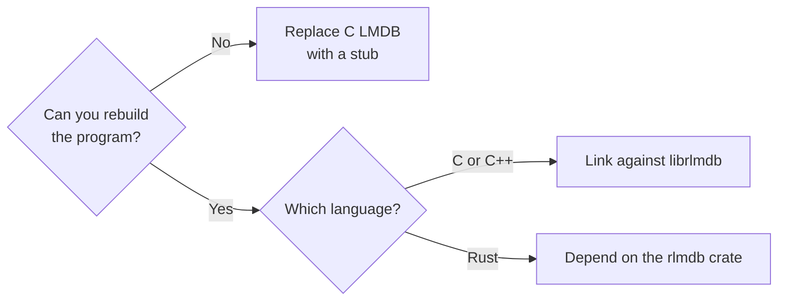

# Getting started

There are three ways to use rlmdb. Which one fits depends on whether you
can rebuild the program, and on its language.



- [Replace C LMDB in an existing program](replace-c-lmdb.md): the program
  stays as it is. You change which library it loads.
- [Use rlmdb in a C program](c-program.md): you compile against `lmdb.h`
  as before and link with `-lrlmdb`.
- [Use rlmdb in Rust](rust.md): you add the `rlmdb` crate. Nothing needs
  to be installed.

All three work on the same files. You can start with a stub and relink
later, or move one program to Rust while the others stay on C LMDB.

## Install the C libraries

The first two paths need rlmdb's C libraries. You need Rust 1.85 or
later ([rustup.rs](https://rustup.rs)) to build them.

```sh
git clone https://github.com/wojas/rlmdb
cd rlmdb
scripts/install-libs.sh
```

This builds the libraries and installs them into `/usr/local`. Set
`PREFIX` to install somewhere else, for example a directory you can write
to without root:

```sh
PREFIX=$HOME/.local scripts/install-libs.sh
```

You get one library to link against, and two stubs:

```text
/usr/local
├── include/rlmdb/
│   ├── lmdb.h                      the LMDB 1.0 header, unmodified
│   └── rlmdb.h                     rlmdb's own functions
└── lib/
    ├── librlmdb.so, librlmdb.a     link new programs against these
    ├── pkgconfig/rlmdb.pc
    └── rlmdb/
        ├── lmdb-0.9/liblmdb.so.0   stub for programs built for LMDB 0.9
        └── lmdb-1.0/liblmdb.so     stub for programs built for LMDB 1.0
```

On macOS the shared libraries end in `.dylib`. On Windows they are
`rlmdb.dll` and, for the stubs, `lmdb.dll`.

The stubs have their own directories, which are not on the default
library path. A stub never replaces an installed C LMDB by accident.

!!! note "Other platforms and packaging"

    On Linux, run `ldconfig` after installing into a system directory. On
    Windows, run the script from MSYS2 or Git Bash. `DESTDIR`, `LIBDIR`
    and `INCLUDEDIR` work as they do with `make install`.

## The command-line tools

The tools are built separately:

```sh
cargo build --release -p rlmdb-tools
```

This puts `rlmdb_stat`, `rlmdb_dump`, `rlmdb_load`, `rlmdb_copy` and
`rlmdb_drop` into `target/release/`. Each one does what the C tool
named with `mdb_` instead of `rlmdb_` does: `rlmdb_stat` takes the
options of `mdb_stat` and prints the same output, so the LMDB man pages
apply. The different names let you install them next to the C tools.
