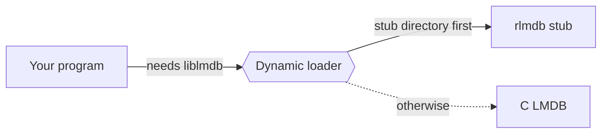

# Replace C LMDB in an existing program

A program that loads C LMDB as a shared library can run on rlmdb without
a rebuild. You point the dynamic loader at a *stub*: rlmdb under the name
`liblmdb`. The program finds the functions it expects and never notices
the difference.



The files stay the same, so this is easy to try and easy to undo.

## Before you start

[Install the C libraries](index.md#install-the-c-libraries). The examples
below assume the default prefix, `/usr/local`.

## 1. Check how the program loads LMDB

=== "Linux and BSD"

    ```console
    $ ldd ./prog | grep lmdb
            liblmdb.so.0 => /usr/lib/x86_64-linux-gnu/liblmdb.so.0
    ```

=== "macOS"

    ```console
    $ otool -L ./prog | grep lmdb
            /opt/homebrew/opt/lmdb/lib/liblmdb.dylib
    ```

=== "Windows"

    Look for `lmdb.dll` next to the program or on `PATH`.

If LMDB does not show up, it is compiled into the program, and a stub
cannot take its place. Relink the program instead: see
[Use rlmdb in a C program](c-program.md).

Programs in Python, Go and other languages often load LMDB through a
binding. Check the binding's shared module then, not the interpreter.

## 2. Pick the stub

There are two stubs, one for each LMDB release series.

| The program was built for | Use the stub in |
|---|---|
| LMDB 0.9 | `/usr/local/lib/rlmdb/lmdb-0.9` |
| LMDB 1.0 | `/usr/local/lib/rlmdb/lmdb-1.0` |

Almost every packaged LMDB today is 0.9. If in doubt, check the version
of the LMDB package the program was built with.

Both stubs contain the same code. They differ in the version they report
and in the format of the environments they create: the 1.0 stub creates
1.0 files, which C LMDB 0.9 cannot open. Existing files keep their format
with either stub.

## 3. Run the program on the stub

=== "Linux and BSD"

    Put the stub's directory first in the loader's search path:

    ```sh
    LD_LIBRARY_PATH=/usr/local/lib/rlmdb/lmdb-0.9 ./prog
    ```

=== "macOS"

    Put the stub's directory first in the loader's search path:

    ```sh
    DYLD_LIBRARY_PATH=/usr/local/lib/rlmdb/lmdb-0.9 ./prog
    ```

    macOS removes `DYLD_*` variables for system binaries and for anything
    started through them, such as a `/bin/sh` script. Start the program
    directly.

=== "Windows"

    Copy `lmdb.dll` from the stub's directory into the directory of the
    program's `.exe`. Windows looks there first.

## 4. Check that it worked

Ask the loader which library it picks:

=== "Linux and BSD"

    ```console
    $ LD_LIBRARY_PATH=/usr/local/lib/rlmdb/lmdb-0.9 ldd ./prog | grep lmdb
            liblmdb.so.0 => /usr/local/lib/rlmdb/lmdb-0.9/liblmdb.so.0
    ```

=== "macOS"

    ```console
    $ DYLD_LIBRARY_PATH=/usr/local/lib/rlmdb/lmdb-0.9 DYLD_PRINT_LIBRARIES=1 ./prog 2>&1 | grep lmdb
    dyld[9975]: <B66C7FEE-…> /usr/local/lib/rlmdb/lmdb-0.9/liblmdb.dylib
    ```

A program that logs its LMDB version shows it too. The stubs report
0.9.85 and 1.0.85, a patch level no C release has:

```text
LMDB 0.9.85: (rlmdb 0.0.0)
```

## Make it permanent

An environment variable is fine for a test. For a program that should
stay on rlmdb, pick what fits how it is started:

- **A service.** Set the variable in the service definition. With
  systemd:

    ```ini
    [Service]
    Environment=LD_LIBRARY_PATH=/usr/local/lib/rlmdb/lmdb-0.9
    ```

- **A program with its own library path.** If `LD_LIBRARY_PATH` has no
  effect because the program carries a path to C LMDB (an rpath),
  preload the stub instead:

    ```sh
    LD_PRELOAD=/usr/local/lib/rlmdb/lmdb-0.9/liblmdb.so.0 ./prog
    ```

- **A package.** Point the program's rpath at the stub's directory, or
  install the stub in place of the C library.

## Settings without changing the program

A program written for C LMDB cannot call rlmdb's own functions. Three
environment variables cover what it would need them for:

| Variable | What it does |
|---|---|
| `RLMDB_FEATURES` | Turns [features](../features/index.md) on or off by name. |
| `RLMDB_DEFAULT_FORMAT` | Sets the format of new environments: `0.9` or `1.0`. Experimental. |
| `RLMDB_IGNORE_ENV` | Set it to `1` to make rlmdb ignore the other two. |

For example, to turn on
[`split-freelist`](../features/split-freelist.md),
which keeps large deletes from growing the file:

```sh
RLMDB_FEATURES=split-freelist LD_LIBRARY_PATH=/usr/local/lib/rlmdb/lmdb-0.9 ./prog
```

A name rlmdb does not know makes the program fail to open its
environment, so a typo does not go unnoticed:

```text
RLMDB_UNKNOWN_FEATURE: Unknown feature
```

## Going back

Remove the variable, or the copied DLL, and the program loads C LMDB
again. Nothing needs converting: rlmdb writes the files C LMDB writes.

You do not have to move everything at once either. Programs on C LMDB and
programs on rlmdb can use the same environment at the same time.

## What may behave differently

Most programs run unchanged. A few things to know:

- Opening the same environment twice in one process fails with `EBUSY`.
  C LMDB allows it, but it is unsafe there.
- Mistakes that crash C LMDB, such as passing a NULL handle, return
  `EINVAL`.
- Encrypted or checksummed LMDB 1.0 files do not open. rlmdb does not
  implement those two features.
- Load only one rlmdb library into a process: one stub, or `librlmdb`.

The [complete list of differences](https://github.com/wojas/rlmdb/blob/main/rlmdb-capi/DETAILS.md#differences-from-c-lmdb-0937)
is in the repository.
