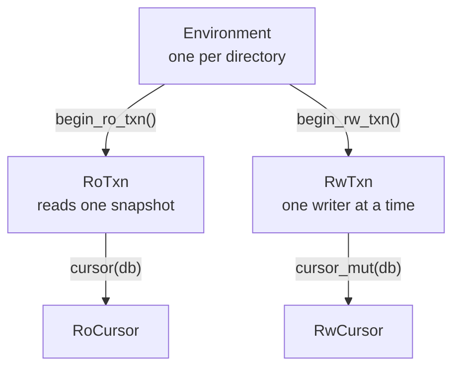

# Use rlmdb in Rust

The `rlmdb` crate is the database itself, written in Rust. It links no C
code and needs nothing installed. Its API follows LMDB's: environments,
transactions, databases and cursors, with keys and values as byte slices.

This page builds a small program that stores users, lists them and
searches them.

## Add the dependency

rlmdb is not on crates.io yet. Depend on the repository:

```toml title="Cargo.toml"
[dependencies]
rlmdb = { git = "https://github.com/wojas/rlmdb" }
```

It needs Rust 1.85 or later.

## Store and fetch

An LMDB *environment* is a directory with a data file and a lock file.
It holds one or more *named databases*, each with its own keys.
Everything you read or write happens in a transaction.

This program stores five users in a database named `users`, with the name
as the key and the e-mail address as the value, and reads one back:

```rust title="src/main.rs"
use rlmdb::{DatabaseFlags, Environment, Transaction, WriteFlags};

fn main() -> Result<(), Box<dyn std::error::Error>> {
    std::fs::create_dir_all("data")?; // the directory must exist
    let env = Environment::builder()
        .max_dbs(32) // named databases this process can have open
        .open("data")?;

    // Open the database "users". The first run creates it.
    let users = env.create_db(Some("users"), DatabaseFlags::CREATE)?;

    // Store the users in one write transaction.
    let mut txn = env.begin_rw_txn()?;
    for (name, email) in [
        ("alice", "alice@example.com"),
        ("bob", "bob@example.com"),
        ("carla", "carla@example.com"),
        ("carlos", "carlos@example.com"),
        ("dave", "dave@example.com"),
    ] {
        txn.put(users, name.as_bytes(), email.as_bytes(), WriteFlags::empty())?;
    }
    txn.commit()?;

    // Fetch one user in a read transaction.
    let txn = env.begin_ro_txn()?;
    match txn.get(users, b"carla")? {
        Some(email) => println!("carla: {}", String::from_utf8_lossy(email)),
        None => println!("carla: not found"),
    }

    // The next two sections add code here.

    Ok(())
}
```

```console
$ cargo run
carla: carla@example.com
```

Four things to take from it:

- **Use a named database for each kind of record.** One transaction can
  change several of them together, and adding one later is a single
  line. LMDB keeps the names in the environment's main database, so keep
  your own records out of that one.
- **A write is visible when its transaction commits.** Until then no
  other transaction sees it. Dropping the transaction without a commit
  discards its changes.
- **A read transaction sees one snapshot.** Writers do not block it, and
  what it reads does not change while it runs.
- **`get` does not copy.** The slice it returns points into the database
  and borrows the transaction, so the compiler keeps you from using it
  after the transaction ends.

`put` replaces the value of a key that exists; pass
`WriteFlags::NO_OVERWRITE` to get an error instead. `del` removes a key
and tells you whether it was there:

```rust
let mut txn = env.begin_rw_txn()?;
txn.put(users, b"bob", b"robert@example.com", WriteFlags::empty())?;
let removed = txn.del(users, b"dave", None)?; // true if the key was there
txn.commit()?;
```

## Iterate with a cursor

LMDB keeps keys sorted, byte by byte. A cursor walks them in that order.
Add this where the comment is:

```rust
let mut cursor = txn.cursor(users)?;
while let Some((name, email)) = cursor.next()? {
    println!("{}: {}", String::from_utf8_lossy(name), String::from_utf8_lossy(email));
}
```

```text
alice: alice@example.com
bob: bob@example.com
carla: carla@example.com
carlos: carlos@example.com
dave: dave@example.com
```

`next` on a new cursor starts at the first key. To walk backwards, start
with `cursor.last()` and continue with `cursor.prev()`.

## Search with a range query

Because the keys are sorted, a search is a jump followed by a walk.
`set_range` moves the cursor to the first key that is equal to or greater
than the one you give. From there, `next` continues in order until the
keys no longer match.

Here is a search for every name that starts with `car`:

```text
alice
bob
carla     ←  set_range(b"car") lands here: the first key ≥ "car"
carlos    ←  next()
dave      ←  next(): does not start with "car", so stop
```

```rust
let prefix = b"car";
let mut entry = cursor.set_range(prefix)?;
while let Some((name, email)) = entry {
    if !name.starts_with(prefix) {
        break;
    }
    println!("{}: {}", String::from_utf8_lossy(name), String::from_utf8_lossy(email));
    entry = cursor.next()?;
}
```

```text
carla: carla@example.com
carlos: carlos@example.com
```

The search goes straight to the first match and reads only the matches.
It does not scan the database.

The same loop answers "everything from A up to B": start at A and stop at
the first key that is not below B.

```rust
let (start, end) = (&b"b"[..], &b"d"[..]);
let mut entry = cursor.set_range(start)?;
while let Some((name, _email)) = entry {
    if name >= end {
        break;
    }
    println!("{}", String::from_utf8_lossy(name)); // bob, carla, carlos
    entry = cursor.next()?;
}
```

This is why key design matters in LMDB. Choose keys so that the entries
you want to find together sort together:

- Keys are bytes, so they need not be text. A Unix timestamp stored as
  8 bytes, big-endian, sorts by time:
  `timestamp.to_be_bytes()`. A time window is then a
  range.
- Store every number in a key that way: big-endian, with a fixed width.
  Little-endian numbers do not sort by value.
- Text works too when it sorts the way you search. Timestamps such as
  `2026-11-12T10:15:00Z` sort by time.
- Keys with a common prefix, such as `order/1042/item/3`, keep one
  order's items next to each other.

## How the pieces fit



Each arrow is also a borrow. A cursor cannot outlive its transaction,
and a transaction cannot outlive its environment. The rules that
`lmdb.h` states as "do not…" are compile errors here. For example, a
value read in a write transaction cannot be used after the next write,
which may move it:

```rust
let mut txn = env.begin_rw_txn()?;
let email = txn.get(users, b"alice")?.unwrap();
txn.put(users, b"bob", b"robert@example.com", WriteFlags::empty())?;
println!("{email:?}");
```

```text
error[E0502]: cannot borrow `txn` as mutable because it is also borrowed as immutable
```

Copy the value first (`email.to_vec()`) if you need it across the write.

Two rules concern threads. Threads share one `Environment`, and any
number of them can read at the same time, each in its own `RoTxn`. A write transaction stays on the thread
that began it, and a second writer waits until the first one ends.

## Settings worth knowing

The builder sets up the environment before it opens:

```rust
let env = Environment::builder()
    .map_size(1 << 30) // the data file may grow to 1 GiB
    .max_dbs(32)       // named databases this process can have open
    .open("data")?;
```

- **`map_size`** is the largest size the data file can reach. The
  default is 1 MiB, as in C LMDB, which is too small for most programs.
  Past the limit, writes fail with `MdbError::MapFull`. It reserves
  address space, not disk space, so be generous.
- **`max_dbs`** is how many named databases this process can have open
  at once. It sizes a table in memory. It is not stored in the file, and
  it does not limit how many databases the environment contains. The
  default is none, so set it before you open one.
- **`format(Format::V10)`** creates the environment in the format of
  LMDB 1.0, which allows longer keys. The default is 0.9, the format
  of the C LMDB that most programs use today. C LMDB 0.9 and 1.0 each
  open only their own format. An existing environment keeps its format.
- **`enable_feature("split-freelist")?`** turns on a
  [feature](../features/index.md) by name.

Unlike the C library, the Rust library reads no environment variables
unless you ask for it with `.read_environment(true)`.

## API reference

The [Rust API reference](../api/rlmdb/index.html) describes every type
and function of the crate. It is generated from the source, and the same
pages come out of `cargo doc -p rlmdb --open` in a project that depends
on rlmdb.

Keys and values are bytes for now. A typed layer in the style of `heed`
is planned.
