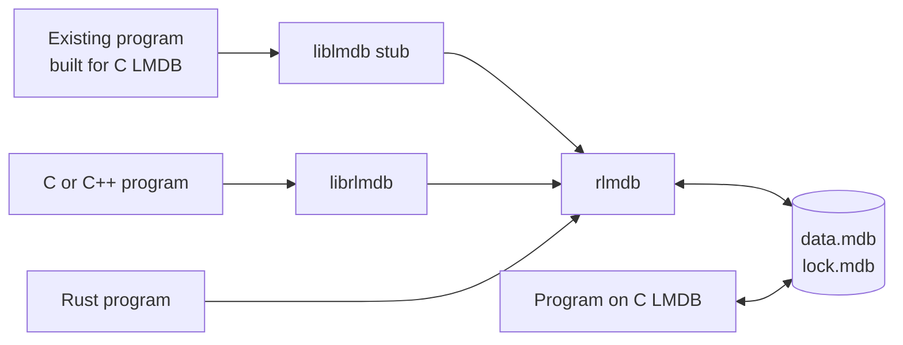

# rlmdb

rlmdb is a drop-in replacement for the [LMDB](http://www.lmdb.tech/) C
library. Programs that use LMDB, in C or through a binding in another
language, run on it unchanged. It reads and writes the same data and lock
files as C LMDB, so programs on rlmdb and programs on C LMDB can use one
environment at the same time.

rlmdb is written in Rust. Rust programs can also use it directly, through
a Rust API.

## What you get

- **A C library.** `librlmdb` has the complete LMDB C API. Programs and
  language bindings written for C LMDB compile against it unchanged.
- **Stubs for programs that are already built.** A stub is rlmdb under
  the name `liblmdb`. Put it in front of C LMDB and the program runs on
  rlmdb without a rebuild.
- **The `mdb_*` tools.** `mdb_stat`, `mdb_dump`, `mdb_load`, `mdb_copy`
  and `mdb_drop`, with the options and output of the C tools.
- **A Rust library.** The `rlmdb` crate has a safe API and links no C
  code.

## Where to start

- **You have a program that uses C LMDB**

    ---

    Run it on rlmdb without rebuilding it.

    [Replace C LMDB in an existing program](getting-started/replace-c-lmdb.md)

- **You write C or C++**

    ---

    Link your program against `librlmdb`.

    [Use rlmdb in a C program](getting-started/c-program.md)

- **You write Rust**

    ---

    Add the crate and open an environment.

    [Use rlmdb in Rust](getting-started/rust.md)

## Good to know

- **Two file formats.** LMDB 0.9 and LMDB 1.0 store data differently.
  rlmdb opens both. New environments are 0.9 unless you ask for 1.0.
- **Damaged files give errors.** Every read is bounds-checked, so a
  corrupt or crafted file does not crash the program.
- **Speed.** On x86-64 Linux, reads are as fast as C LMDB. Writes take
  about 13% longer on average, and up to 49% longer for sequential
  appends. The
  [benchmark results](https://github.com/wojas/rlmdb/blob/main/bench/RESULTS.md)
  have the numbers.
- **Platforms.** Tested on 64-bit Linux, macOS, Windows, FreeBSD and
  OpenBSD. Other 64-bit platforms that C LMDB runs on, such as NetBSD,
  DragonFly and Android, are likely to work but are not tested yet.
- **Status.** rlmdb has no release yet. You build it from the
  [repository](https://github.com/wojas/rlmdb).
