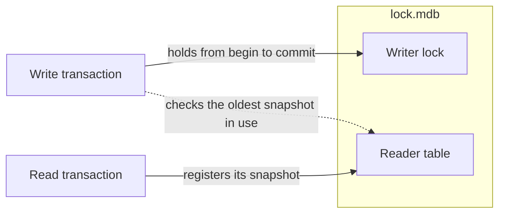

# How locking works

An environment can be used by many threads and many processes at once.
The lock file, `lock.mdb`, is what keeps them out of each other's way.
This page explains what it does, what it costs, and what to do when it
gets in your way.

rlmdb uses the lock file exactly as C LMDB does. That is what lets
programs on rlmdb and programs on C LMDB share an environment.

## The rules in short

- **Readers never wait.** Any number of read transactions run at the same
  time. Each reads one snapshot: the state of the last commit when it
  began.
- **One writer at a time.** A second write transaction waits until the
  first one commits or aborts.
- **Readers and writers do not block each other.** A commit does not
  change what a running read transaction sees.

```text
time ──────────────────────────────────────────────────────────▶

Writer A   ├─ write ─┤ commit 8
Writer B      waits ··├─ write ─┤ commit 9
Reader 1   ├───────── reads snapshot 7 ─────────┤
Reader 2               ├──── reads snapshot 8 ────┤
```

Writer B starts when A has committed, and builds on A's commit. Reader 1
began before either commit and keeps reading snapshot 7 until it ends.

## What is in the lock file

`lock.mdb` sits next to `data.mdb`. It holds no data of yours. It has two
jobs:



- The **writer lock** lets one write transaction in at a time.
- The **reader table** has one slot for each read transaction that is
  running. The slot names the process, the thread and the snapshot.

The writer lock is a different mechanism on each platform. See
[Lock implementations by platform](platforms.md). The reader table works
the same way everywhere.

## Write transactions

A write transaction takes the writer lock when it begins and gives it
back when it commits or aborts. Every other write transaction, in any
thread or process, waits in the meantime. There is no timeout.

So keep write transactions short. Do the slow work first, such as
reading input or calling another service, and begin the write
transaction when the data is ready.

## Read transactions

A read transaction takes no lock while it reads. When it begins, it
writes the snapshot it uses into its slot of the reader table. You can
see the table with `mdb_stat -r`:

```console
$ mdb_stat -r data
Reader Table Status
    pid     thread     txnid
     63142 200e09200 1
```

Writers read this table too. A page that a commit frees can only be used
again when no read transaction still needs it. So a read transaction
that stays open keeps old pages alive, and the data file grows.

The effect is large. In a test that rewrote the same 1,000 records 100
times, the environment used 212 pages. With one read transaction open
from start to end, it used 7,149.

End a read transaction when you are done with it. If you keep one handle
for a long time, release its snapshot between uses:

=== "C"

    ```c
    mdb_txn_reset(txn);     /* gives up the snapshot, keeps the slot */
    /* ... later ... */
    mdb_txn_renew(txn);     /* reads the latest snapshot */
    ```

=== "Rust"

    ```rust
    let idle = txn.reset();     // gives up the snapshot, keeps the slot
    // ... later ...
    let txn = idle.renew()?;    // reads the latest snapshot
    ```

## Read-only environments

A program that opens an environment read-only still uses the lock file.
Its read transactions must be in the reader table, or writers in other
processes would reuse the pages they read. So a read-only program needs
write permission on `lock.mdb`.

!!! warning "Read-only file systems"

    On a read-only file system the lock file cannot be opened for
    writing, and the environment opens without one, as in C LMDB. That
    is safe when nobody can write the environment. It is not safe when
    another process writes it through a writable mount of the same
    directory, such as a volume that one container mounts read-only and
    another read-write. The reader is then invisible to the writer.

## Opening and closing

The first process to open an environment sets the lock file up: it
creates the writer lock and clears the reader table. Processes that open
it later attach to what is there.

Two things follow:

- Whatever a crash left in the lock file is gone once every process has
  closed the environment and one opens it again. You never need to
  delete `lock.mdb` to repair it.
- Never delete `lock.mdb` while a process has the environment open. The
  next process to open it would create a new lock file and write without
  seeing the others.

## When it gets in your way

### A crashed process left readers behind

A process that dies in a read transaction leaves its slot in the table.
The slot keeps old pages alive, as an open read transaction would.
Other processes do not notice by themselves. Clear such slots with
`mdb_stat -rr`:

```console
$ mdb_stat -rr data
Reader Table Status
    pid     thread     txnid
     63650 200e09200 1
  1 stale readers cleared.
(no active readers)
```

A program can do the same with `mdb_reader_check` in C, or
`env.reader_check()` in Rust. A long-running service can call it now
and then, for example when it starts and once a minute.

### The reader table is full

A read transaction that finds no free slot fails with
`MDB_READERS_FULL`. There are 126 slots by default.

First clear stale readers, as above. If you really run more read
transactions than that at once, raise the limit with
`mdb_env_set_maxreaders` in C or `.max_readers(n)` in Rust. The size is
fixed when the lock file is set up, so a higher limit takes effect after
every process has closed the environment.

### Opening the environment a second time fails

A process can open an environment once. A second open in the same
process fails with `EBUSY`. Open it once and share the handle between
threads.

C LMDB allows the second open, but the two handles then break each
other's locks.

### Write transactions wait forever

Either a process holds a write transaction open, or a process died
while it held the writer lock. What happens after a crash depends on the
platform: most recover by themselves, some do not. The page of your
platform's [lock implementation](platforms.md) says which, and what to
do.

## What an environment needs from the system

- **A local file system.** Do not put an environment on a network file
  system. File locks and shared memory do not work reliably there.
- **Processes of the same kind.** Every process that shares an
  environment must run on the same operating system, with the same byte
  order and the same C library. A mismatch is not always reported.
  [Lock implementations by platform](platforms.md#who-can-share-an-environment)
  has the details.

If you cannot meet these, or you need no coordination at all, see
[Running without locks](nolock.md).
