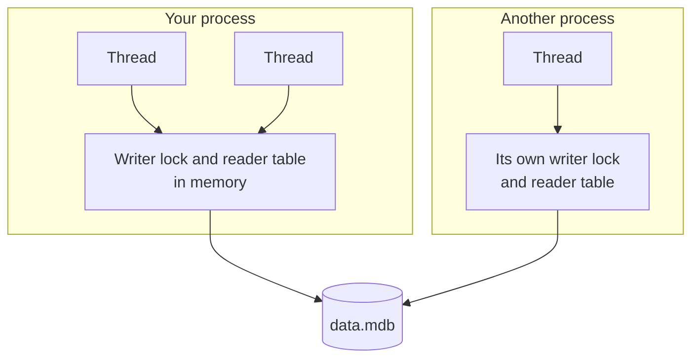

# Running without locks

With the `MDB_NOLOCK` flag an environment has no lock file. Nothing
coordinates it between processes any more.

!!! warning "Only for environments that one process uses"

    Without a lock file, nothing stops a second process from writing
    while yours reads or writes. The result is a damaged environment or
    wrong data, without an error at the time it happens. Use this flag
    only when you know that no other process touches the environment
    while yours has it open.

## What it turns off

- There is no `lock.mdb`.
- Write transactions of different processes are not kept apart.
- Read transactions are not visible to other processes, so a writer in
  another process may reuse pages that your reader still reads.

## When it is a reasonable choice

- **One process is the only user.** An application with its own private
  database, or a service that owns its data directory.
- **The data never changes.** A data set that is shipped read-only, or a
  copy that nobody writes. Any number of processes can read it.
- **You lock between processes yourself**, for example with an exclusive
  lock on another file that every program takes before it opens the
  environment.

## What rlmdb still does for you

In C LMDB, `MDB_NOLOCK` also removes the coordination inside your own
process. The program must make sure that only one write transaction
runs, and that no read transaction is active while it does.

rlmdb keeps that coordination. It moves it from the lock file into the
memory of the process:



The two processes in the picture do not see each other. Inside yours,
rlmdb coordinates everything:

- **Write transactions wait for each other**, in all threads.
- **Read transactions are tracked.** A writer never reuses a page that a
  running read transaction of the process still needs.

So inside one process, an environment without a lock file behaves like
one with a lock file. Threads can read and write as they like.

| | C LMDB | rlmdb |
|---|---|---|
| Two write transactions in one process | You must prevent it | The second waits |
| A read transaction during a write | You must prevent it | Safe |
| Another process | You must prevent it | You must prevent it |

For example, a read transaction keeps its snapshot while the same
process commits ten changes to the value it read:

```rust
let reader = env.begin_ro_txn()?;
let seen = reader.get(users, b"alice")?.unwrap();
for i in 0..10 {
    let mut txn = env.begin_rw_txn()?;
    let email = format!("alice{i}@example.com");
    txn.put(users, b"alice", email.as_bytes(), WriteFlags::empty())?;
    txn.commit()?;
}
println!("reader still sees {}", String::from_utf8_lossy(seen));
```

```text
reader still sees alice@example.com
```

If one process opens the environment more than once with `MDB_NOLOCK`,
all its handles share the same writer lock and reader table.

## What it cannot do

It cannot see other processes. Each process has its own writer lock and
reader table, as the diagram shows.

- Two processes that write at the same time damage the environment.
- A process that reads while another one writes can get wrong data or
  `MDB_CORRUPTED`.
- A process with `MDB_NOLOCK` is invisible to processes that use the
  lock file, and they are invisible to it. Do not mix the two on one
  environment.

This includes the `mdb_*` tools, which use a lock file. Run `mdb_stat`,
`mdb_dump` or `mdb_copy` on such an environment only while your program
is stopped. To make a backup while it runs, let the program copy the
environment itself, with `mdb_env_copy` in C or `env.copy_to_path` in
Rust.

## Turning it on

=== "C"

    ```c
    mdb_env_open(env, "./data", MDB_NOLOCK, 0644);
    ```

=== "Rust"

    ```rust
    use rlmdb::{Environment, EnvironmentFlags};

    let env = Environment::builder()
        .max_dbs(32)
        .flags(EnvironmentFlags::NO_LOCK)
        .open("data")?;
    ```

A process cannot have the same environment open with a lock file and
without one. The second open fails with `EBUSY`.

## Read-only file systems

An environment that is opened read-only on a read-only file system also
runs without a lock file, because the lock file cannot be written.
Everything on this page applies to it.
