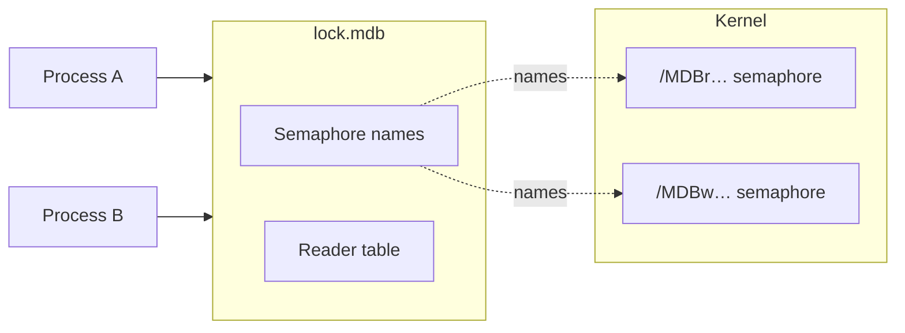

# POSIX named semaphores

Used on macOS for both formats, and on OpenBSD, NetBSD and DragonFly for
environments in format 0.9.

This implementation has one weakness you should know before you rely on
it: the semaphores do not notice when their holder dies. A process that
is killed in a write transaction leaves the writer lock taken, and every
other writer waits until you step in. C LMDB has the same weakness on
these platforms.

## How it works

The two locks are semaphores that live in the kernel and are found by
name. The names start with `/MDBr` for the reader table and `/MDBw` for
the writer, followed by a code that is derived from the lock file.



- The first process to open the environment removes any semaphores left
  under these names, creates two new ones, and records them in
  `lock.mdb`.
- Later processes read the lock file and open the semaphores by name.
- The last process to close the environment removes them again.

A semaphore is taken by counting it down and released by counting it up.
It has no owner. That is the cause of the weakness: when a process dies,
the kernel has nothing to tell it that the count should go up again.

## If a process dies holding the lock

Nothing releases the writer lock. From then on:

- Every write transaction, in every process, waits forever. It does not
  fail, and there is no timeout.
- Read transactions go on as before.
- Processes that open the environment later attach to the same
  semaphores and wait too.

The same is true for a thread that exits with a write transaction still
open.

The lock for the reader table is held only for a moment, when a read
transaction gets its slot. A process that dies in that moment blocks new
read transactions in the same way. This is rare.

## Getting writers going again

The semaphores are replaced when a process opens the environment while
no other process has it open. So the way out is to close it everywhere:

1. Find the processes that have the environment open:

    ```sh
    lsof data/lock.mdb
    ```

    The second column of the output is the process ID.

2. Stop all of them. A process that waits for the writer lock may not
   shut down in the normal way, so you may have to kill it.
3. Start them again. The first one to open the environment creates new
   semaphores, and writers run again.

The data is not affected. The write transaction of the dead process was
never committed.

!!! warning "Do not delete the lock file to fix this"

    Deleting `lock.mdb` while a process still has the environment open
    does not help that process, and it lets the next one write without
    seeing it. Close the environment everywhere instead. After that the
    lock file needs no repair.

## Avoiding it

- **Shut processes down cleanly.** Handle the termination signal, abort
  the write transaction and close the environment. Keep `kill -9` for
  processes that do not react.
- **Keep write transactions short.** A process can only leave the lock
  taken if it dies inside a write transaction.
- **Use format 1.0 on OpenBSD, NetBSD and DragonFly** if this matters to
  you. Environments in format 1.0 use
  [SysV semaphores](sysv-semaphores.md) there, which recover by
  themselves. macOS has no alternative.

## Limits

- **No recovery after a crash**, as described above.
- **The names are tied to the lock file.** They are derived from the
  file's identity on disk and stored in it. A copy of the directory gets
  its own lock file and its own semaphores when it is first opened.
- **A local file system.**

## Troubleshooting

| What you see | What to do |
|---|---|
| All writers wait, and no process is in a write transaction | A writer died. Close the environment in every process, then start again. |
| Writers wait and one process is in a long write transaction | End that transaction or that process cleanly. |
| New read transactions wait as well | A process died while it took a reader slot. Same fix. |
| The data file keeps growing | Look for long or stale readers: [How locking works](index.md#when-it-gets-in-your-way). |
