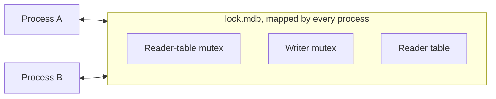

# Robust pthread mutexes

Used on Linux, Android and FreeBSD, for both formats.

This is the most forgiving of the lock implementations. When a process
dies while it holds a lock, the next one to take the lock is told so and
repairs the state. You do not have to do anything.

## How it works

The two locks are pthread mutexes that are stored inside `lock.mdb`.
Every process maps the lock file into its memory, so they all work on
the same two mutexes.



Two properties of the mutexes matter:

- **Process-shared.** A thread of any process can lock them.
- **Robust.** The kernel knows which thread holds each mutex. If that
  thread dies, the kernel marks the mutex, and the next thread that
  locks it learns that its owner is gone.

There is nothing for you to list or to clean up outside the lock file.

## If a process dies holding the lock

The next write transaction, in any process, gets the lock together with
the news that its owner died. Before it continues, it:

1. looks up the last commit that reached the data file,
2. clears the reader slots of dead processes,
3. marks the mutex as usable again.

Then it runs as usual. Changes that were not committed are gone. If the
process died at the very end of a commit, that commit may be complete
and visible.

The same happens for the reader-table mutex.

## What can still block

**A live process that keeps a write transaction open.** Every other
writer waits, without a timeout. The lock does not tell you who holds
it. List the processes that have the environment open and look for the
one that is stuck:

```sh
lsof data/lock.mdb
```

When that process ends, or is killed, the next writer recovers as
described above.

**A thread that exits with a write transaction still open**, while its
process lives on. Writers in other processes recover. Writers in the
same process wait forever, because that process still counts the
transaction as running. This is a bug in the program: always commit or
abort. Restart the process to get out of it.

In Rust this cannot happen by accident: a write transaction cannot move
to another thread, and dropping it aborts it.

## Limits

- **One thread per write transaction.** A pthread mutex belongs to the
  thread that locked it. End a write transaction on the thread that
  began it.
- **The same C library in every process.** The size and the content of a
  mutex are private to the C library: 40 bytes with glibc on x86-64, 48
  on arm64, 8 on FreeBSD. glibc and musl do not agree on it. A mismatch
  is not always reported. With format 1.0 some are caught when the
  environment is opened (`MDB_VERSION_MISMATCH`). With format 0.9 none
  are. The open then succeeds and the locks do not work: writers hang,
  or two write at once and damage the environment. See
  [Who can share an environment](platforms.md#who-can-share-an-environment).
- **A local file system.** Robust mutexes in a file need shared memory
  that the kernel manages on one machine.

## Troubleshooting

| What you see | What to do |
|---|---|
| Writers wait and one process is in a long write transaction | End that transaction or that process. |
| Writers wait in one process only | A thread left a write transaction open. Restart the process. |
| `MDB_VERSION_MISMATCH` when opening | A process of another kind has the environment open. Do not let them share it. |
| Hangs or `MDB_CORRUPTED` after a new kind of program joined | Suspect a mismatch that was not reported. Stop all processes and check who shares the environment. |
| The data file keeps growing | Look for long or stale readers: [How locking works](index.md#when-it-gets-in-your-way). |
