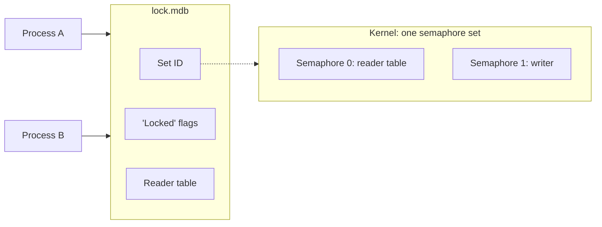

# SysV semaphores

Used on OpenBSD, NetBSD and DragonFly for environments in format 1.0.
Environments in format 0.9 use
[POSIX named semaphores](posix-semaphores.md) on these systems.

SysV semaphores recover by themselves when a process dies while it
holds a lock. In exchange they are a system-wide resource with limits,
owners and leftovers, which you may have to look after.

## How it works

The two locks are the two semaphores of one SysV semaphore set. The set
lives in the kernel. Its key is computed from the lock file, and its ID
is stored in `lock.mdb`.



- The first process to open the environment creates the set and stores
  its ID.
- Later processes read the ID from the lock file and use the same set.
- The last process to close the environment removes the set.

A process that takes a lock also sets a flag in the lock file, and
clears it when it gives the lock back.

## If a process dies holding the lock

The kernel undoes the dead process's change to the semaphore, so the
lock is free again. The flag in the lock file is still set, though. The
next process that takes the lock sees the flag, knows that the previous
holder died, and repairs the state before it continues: it looks up the
last commit that reached the data file and clears the reader slots of
dead processes.

You do not have to do anything. Changes that were not committed are
gone. If the process died at the very end of a commit, that commit may
be complete and visible.

## What can still block

**A live process that keeps a write transaction open.** Every other
writer waits, without a timeout. End that transaction or that process.

**A thread that exits with a write transaction still open**, while its
process lives on. The process still holds the semaphore, so every writer
waits until that process ends.

## Limits

- **The kernel limits the number of semaphore sets.** Each open
  environment in format 1.0 needs one set. The default limits are low on
  some of these systems. If opening fails with `ENOSPC`, look at the
  limits and raise them. On OpenBSD:

    ```sh
    sysctl kern.seminfo
    ```

- **A set belongs to an account.** A process can only attach to a set if
  it runs as the account that created the set, as its owner, or as root.
  Processes of different accounts cannot share an environment in format
  1.0 here. The open fails with a permission error.
- **Keys can collide.** The key is short, so another program's semaphore
  set can have the key of your lock file. rlmdb refuses a set that is
  not its own with `EEXIST`, where C LMDB would take it over. It cannot
  tell every case apart: a set of two semaphores that your own account
  owns looks like a leftover of the environment, and rlmdb takes it
  over.
- **A crash can leave a set behind.** If the last process dies instead
  of closing the environment, its set stays in the kernel. The next
  process to open the environment takes it over, so this only costs a
  set if the environment is never opened again.

## Looking at the sets

`ipcs -s` lists the semaphore sets on the system with their IDs, keys
and owners:

```sh
ipcs -s
```

`ipcrm -s <id>` removes one. Only remove a set when no process has its
environment open.

## Troubleshooting

| What you see | What to do |
|---|---|
| Opening fails with `ENOSPC` | The system is out of semaphore sets. Remove leftover sets or raise the limits. |
| Opening fails with a permission error | Another account created the set. Run the processes as one account. |
| Opening fails with `EEXIST` or `EINVAL` | Another set has the lock file's key. See below. |
| Writers wait and one process is in a long write transaction | End that transaction or that process. |
| The data file keeps growing | Look for long or stale readers: [How locking works](index.md#when-it-gets-in-your-way). |

### Opening fails with `EEXIST` or `EINVAL`

Another semaphore set has the key of the lock file. `EINVAL` means that
set has only one semaphore. Find the set with `ipcs -s`.

- If it is a leftover of this environment that another account created,
  remove it with `ipcrm -s <id>` as that account or as root.
- If it belongs to another program, leave it alone. Make sure no process
  has the environment open, then delete `lock.mdb`. The next open
  creates a new lock file, which usually gets a different key.
