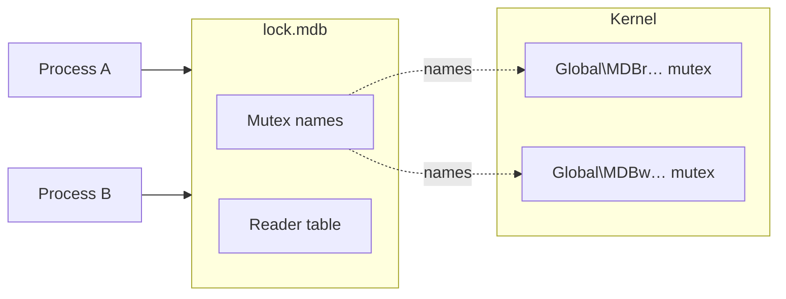

# Windows named mutexes

Used on Windows, for both formats.

Windows mutexes recover by themselves when a process dies while it
holds a lock, and they leave nothing behind. There is little to look
after.

## How it works

The two locks are mutexes that live in the kernel and are found by
name. The names start with `Global\MDBr` for the reader table and
`Global\MDBw` for the writer, followed by a code that is derived from
the lock file.

- The first process to open the environment creates the mutexes and
  records them in `lock.mdb`.
- Later processes read the lock file and open the mutexes by name.
- Windows removes a mutex when the last process closes it. Nothing is
  left behind, also after a crash.

## If a process dies holding the lock

Windows marks the mutex as abandoned. The next write transaction, in any
process, gets the lock together with that mark. Before it continues, it
looks up the last commit that reached the data file and clears the
reader slots of dead processes.

You do not have to do anything. The transaction of the dead process was
never committed.

## What can still block

**A live process that keeps a write transaction open.** Every other
writer waits, without a timeout. End that transaction or that process.

**A thread that exits with a write transaction still open**, while its
process lives on. Writers in other processes recover. Writers in the
same process wait forever, because that process still counts the
transaction as running. Restart the process.

## Limits

- **One thread per write transaction.** A Windows mutex belongs to the
  thread that locked it. End a write transaction on the thread that
  began it.
- **Any account can open the mutexes.** They are created without access
  restrictions, as C LMDB creates them. A program of another user on the
  same machine that knows the name can take the writer lock.
- **Dead readers are found by process ID.** Windows has no file lock
  that would show whether a reader is alive, so a reader check asks
  whether the process still exists. If Windows gave the ID to a new
  process in the meantime, the stale slot stays until that process ends.
- **The files cannot be deleted or renamed while they are open.** This
  protects the lock file from being removed under a running program.

## Troubleshooting

| What you see | What to do |
|---|---|
| Writers wait and one process is in a long write transaction | End that transaction or that process. |
| Writers wait in one process only | A thread left a write transaction open. Restart the process. |
| The data file keeps growing | Look for long or stale readers: [How locking works](index.md#when-it-gets-in-your-way). |
