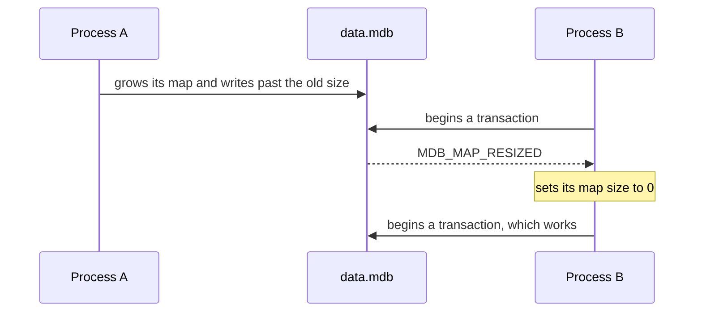

# Map size and file growth

Every environment has a *map size*: the largest size its data file may
reach. The default is 1 MiB, which is far too small for most programs.
So the first error many people meet is this one:

```text
MDB_MAP_FULL: Environment mapsize limit reached
```

This page explains how to choose the map size, how to change it later,
and why a data file grows.

## What the map size is

LMDB reads its data through a memory map of the data file. The map size
is how much address space that map takes. The file itself only grows as
data is written:

```text
0                                                  map size
|---------------------------------------------------|   address space, reserved
|---------------------|                                 data.mdb, on disk
|## used ##...free...#|
```

So a large map size costs nothing. A program that opened an environment
with a map size of 1 GiB and stored 5,000 records of 1 KB each had a
data file of 5.5 MB.

!!! warning "Windows and format 0.9"

    On Windows, an environment in format 0.9 is different: its data file
    is as long as the map, as with C LMDB. Choose the map size there
    with the disk in mind. Environments in format 1.0 grow with their
    data on Windows too.

## Choose a size

Pick the largest size the environment should ever reach, and then add
generously. A map of 100 GiB for a database of 1 GiB is fine on a 64-bit
system.

Set it before you open the environment:

=== "C"

    ```c
    mdb_env_create(&env);
    mdb_env_set_mapsize(env, (size_t)1 << 30);      /* 1 GiB */
    mdb_env_open(env, "./data", 0, 0644);
    ```

=== "Rust"

    ```rust
    let env = Environment::builder()
        .map_size(1 << 30) // 1 GiB
        .open("data")?;
    ```

The size is stored in the data file with the next commit. A program that
opens the environment later without naming a size gets the stored one.
The `mdb_*` tools do that.

## See how full it is

`mdb_stat -ef` shows the map size, the pages in use, and the free pages
among them:

```console
$ mdb_stat -ef data
Environment Info
  Map address: 0x0
  Map size: 1073741824
  Page size: 16384
  Max pages: 65536
  Number of pages used: 1350
  Last transaction ID: 3
  Max readers: 126
  Number of readers used: 0
Freelist Status
  Tree depth: 1
  Branch pages: 0
  Leaf pages: 1
  Overflow pages: 1
  Entries: 2
  Free pages: 1207
```

- **Max pages** is the map size in pages.
- **Number of pages used** is the size of the data file in pages. When
  it reaches *Max pages*, writes fail with `MDB_MAP_FULL`.
- **Free pages** are pages inside the file that hold nothing any more.
  New writes use them before the file grows.

Here the file has 1,350 pages, and 1,207 of them are free: most of the
data was deleted.

## Grow the map later

When a write fails with `MDB_MAP_FULL`, abort the transaction, set a
larger size, and run the transaction again. The environment can stay
open:

=== "C"

    ```c
    mdb_txn_abort(txn);
    mdb_env_set_mapsize(env, (size_t)4 << 30);      /* 4 GiB */
    /* begin the transaction again */
    ```

=== "Rust"

    ```rust
    drop(txn); // aborts it
    env.set_map_size(4 << 30)?; // 4 GiB
    // begin the transaction again
    ```

No write transaction may be open in the process when you change the
size. Read transactions may be: they keep the map they began with.

## When another process grows the map

Each process has its own map. When one process grows its map and writes
past the size that another process still has, that process cannot see
the new data. Its next transaction fails:

```text
MDB_MAP_RESIZED: Database contents grew beyond environment mapsize
```



Setting the map size to 0 means "use the size in the file". Then begin
the transaction again:

=== "C"

    ```c
    rc = mdb_txn_begin(env, NULL, MDB_RDONLY, &txn);
    if (rc == MDB_MAP_RESIZED) {
        mdb_env_set_mapsize(env, 0);
        rc = mdb_txn_begin(env, NULL, MDB_RDONLY, &txn);
    }
    ```

=== "Rust"

    ```rust
    let txn = match env.begin_ro_txn() {
        Err(Error::Mdb(MdbError::MapResized)) => {
            env.set_map_size(0)?;
            env.begin_ro_txn()?
        }
        other => other?,
    };
    ```

A program that shares an environment with others should handle this
error wherever it begins a transaction. You avoid it altogether when
every program opens the environment with the same generous map size.

## Why a data file grows

A data file grows when a write needs a page and no free page can be
used. It never shrinks by itself. Four things make it grow:

- **More data.** The obvious one.
- **A read transaction that stays open.** Pages freed after it began
  cannot be used again until it ends. See
  [Read transactions](../locking/index.md#read-transactions).
- **Readers that a crashed process left behind.** They hold pages in the
  same way, until they are cleared. See
  [A crashed process left readers behind](../locking/index.md#a-crashed-process-left-readers-behind).
- **A large delete.** The record of the pages it frees needs pages of
  its own, in one piece. The
  [`split-freelist`](../features/split-freelist.md) feature avoids this.

When a file keeps growing while the data does not, look at the readers
first:

```sh
mdb_stat -r data
```

## Make a file smaller

Deleting data frees pages inside the file. It does not make the file
shorter. To get a smaller file, make a compacting copy and use the copy:

```sh
mkdir compact
mdb_copy -c data compact
```

In the example above, the file went from 22.1 MB to 2.3 MB.
[Backups](backups.md) describes copies, and how to put one in place.
